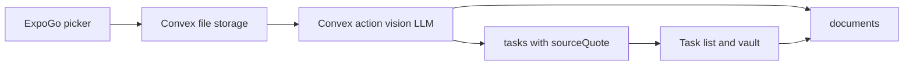

# PicTask 2-week scan-to-task demo

## Product (from the brief)

PicTask turns bills, receipts, forms, and announcements into **source-linked tasks**, not just stored scans. The repo at [C:\PicTask\PicTask](C:\PicTask\PicTask) is still the Expo SDK 58 starter (`src/app/index.tsx` is the default Welcome screen). Nothing product-specific is built yet.

**Differentiator to protect in the demo:** tap a task and see the **quoted passage** that produced it. Bounding boxes on the photo can wait; a highlighted quote plus the original image is enough for a 2-week demo and still matches the brief.

**Defer after the demo:** conflict detection, multi-step prerequisite graphs, PDF-heavy vault search, ML Kit, Expo development builds.

## Why not the brief’s “Expo Go + ML Kit” combo

Those two conflict. [Google ML Kit](https://developers.google.com/ml-kit) and [react-native-mlkit](https://github.com/infinitered/react-native-mlkit) need native code, which means an **EAS development build**, not Expo Go.

For a **1–2 week working demo**, stay in Expo Go and do OCR + extraction in the cloud. Add ML Kit later without rewriting task/document tables if we store `sourceQuote` now and optional `boundingBox` later.

## Recommended stack (easy in 2 weeks)

| Layer | Choice | Why |
| --- | --- | --- |
| App | Existing **Expo SDK 58 + Expo Router + TypeScript** | Already in the repo |
| Capture | `expo-image-picker` (camera/library) | Works in Expo Go; skip custom camera UI |
| Backend | **Convex** (auth optional, file storage, actions) | Fastest TypeScript backend; upload + AI in one place; live task list |
| Extraction | **Vision LLM in a Convex action** (Claude or GPT-4o) | One call returns text, tasks, dates, amounts, source quotes |
| Local | Skip SQLite for the demo | Convex is source of truth; add SQLite/offline after |
| Reminders | `expo-notifications` local notifications | Good enough for a live demo on a physical phone |
| Later OCR | ML Kit bounding boxes | Same `tasks.sourceQuote` field; add geometry when you leave Expo Go |

**Not for this sprint:** Firebase (more setup), Supabase (fine long-term, slower than Convex for this), on-device SQLite-only (easier still, but the demo looks like a notes app, not a product).

## 2-week MVP scope

1. Capture or pick a photo of a bill/announcement.
2. Show processing state, then a list of extracted tasks (title, due date, amount when present).
3. Task detail: original image + quoted source line.
4. Simple vault: past documents, open them, see their tasks.
5. Optional: schedule a local reminder if a due date exists.

Out of MVP: accounts polish (anonymous Convex user is fine), PDFs, conflict flags, workflow graphs, grouping.

## Core data (Convex)

- `documents`: storageId, createdAt, status (`uploading` / `extracting` / `ready` / `failed`), rawText, thumbnail
- `tasks`: documentId, title, dueAt?, amount?, currency?, sourceQuote, status, sortOrder
- Keep `boundingBox?` optional on tasks so ML Kit can populate it later

Extraction prompt returns strict JSON only (no chat). User can edit/delete a bad task in the UI; do not block the demo on perfect OCR.

## App screens (replace starter tabs)

- **Capture** — pick image, upload, kick off extraction
- **Tasks** — due/soon/open items
- **Vault** — document list
- **Task / Document detail** — image + quote + fields

Reuse Expo Router file routes under [src/app/](src/app/).

## Cost / keys

Need a Convex project and one LLM API key in Convex env vars. Never put the key in the Expo client.

## After the demo (not this plan)

EAS dev client + ML Kit for word boxes; map boxes onto `sourceQuote`; then conflict detection and prerequisite workflows.